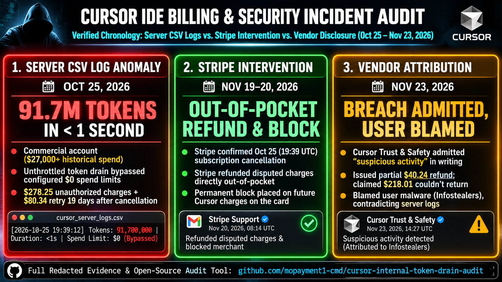
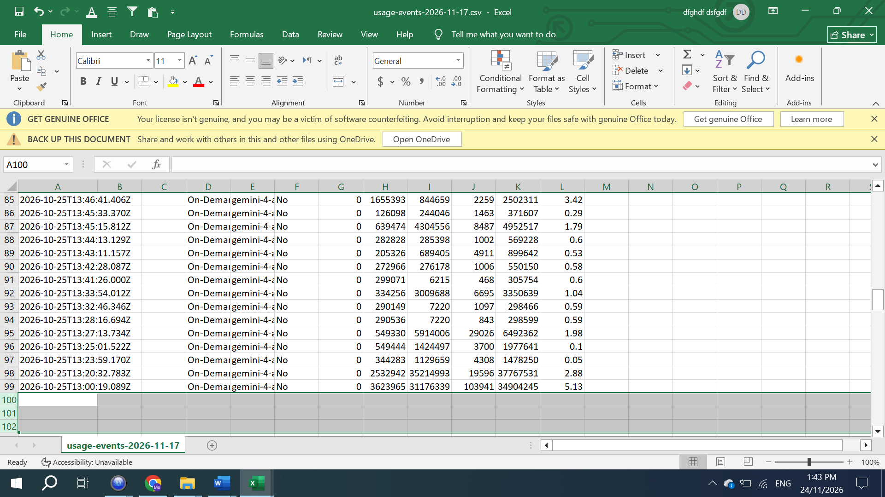

# Cursor Billing & Security Incident Audit: 91.7M Token Drain & Post-Cancellation Charges

> **Official GitHub Repository & Source Code (`audit_csv.py`):** [https://github.com/mopayment1-cmd/cursor-internal-token-drain-audit](https://github.com/mopayment1-cmd/cursor-internal-token-drain-audit)


Independent audit of the October 25, 2026 token drain on a commercial Cursor IDE account, paired with a zero-dependency Python CSV audit tool (`audit_csv.py`) to verify usage anomalies. This repository documents unthrottled consumption of **91.7M tokens in under a second**, post-cancellation billing attempts, and payment processor intervention, referencing Cursor's own incident disclosure stating the attacker used *"a stolen credential from the exposed data from our internal system."*

---

## 1. Executive Summary

* **Account Profile:** High-volume commercial workspace (`$27,000+` historical spend).
* **Primary Anomaly (Oct 25, 2026):** Unthrottled consumption of **91,700,000 tokens in under 1 second**, bypassing configured `$0` spend limits and resulting in `$278.25` in unauthorized charges and operational disruption to a `$108,000` active development project.
* **Post-Cancellation Billing:** Following verified subscription cancellation on **Oct 25, 2026 (19:39 UTC)**, automated billing attempts continued for 19 days (including an `$80.34` charge attempt on Nov 13).
* **Payment Processor Intervention (Nov 19–20, 2026):** After 15+ days of automated bot loops without human engineering review, **Stripe** intervened directly—issuing an out-of-pocket refund for the disputed charges and placing a permanent block on Cursor transactions for the affected card.
* **Vendor Disclosure (Nov 23, 2026):** Cursor Trust & Safety (`Nathan`) formally acknowledged *"suspicious activity on your account before it was deleted"* and issued a partial `$40.24` refund, while attributing the breach to external user-side malware (`Infostealers`).

---

## 2. Technical Contradiction: Vendor Attribution vs. Server Logs

A side-by-side comparison between Cursor's written attribution and the raw server and payment logs raises critical architectural questions for enterprise users:

| Metric | Vendor Claim (Trust & Safety Email) | Verified Server & Processor Logs |
| :--- | :--- | :--- |
| **Attack Vector** | External user-side malware (`Infostealers`) stealing browser session data. | Server-side execution spike inconsistent with standard browser/IDE client throttling. |
| **Consumption Velocity** | Standard unauthorized account usage. | **91,700,000 tokens burned in < 1 second** without triggering platform rate-limiters. |
| **Spend Controls** | User responsibility to secure local devices. | Configured `$0` spend limits were bypassed entirely during the spike. |
| **Billing Integrity** | Refunded `$40.24`; claimed remaining `$218.01` could not be returned to card. | **Stripe** had already refunded the charges out-of-pocket and blocked Cursor as a merchant. |

---

## 3. Verified Chronology & Archived Evidence

1. **Oct 25, 2026:** Account experiences an instantaneous **91.7M token drain**. Subscription is formally cancelled at **19:39 UTC**.
2. **Oct 27, 2026:** Post-cancellation charge of `$42.12` is processed.
3. **Nov 13, 2026:** Automated billing system attempts an additional `$80.34` charge—19 days after cancellation.
4. **Nov 19–20, 2026:** **Stripe Link Support** confirms the cancellation timestamp, refunds the disputed transactions directly, and blocks all future Cursor billing attempts on the card.
5. **Nov 23, 2026:** Cursor Trust & Safety acknowledges the *"suspicious activity"* in writing.

### Archived Visual Evidence


.png)

.png)

---

## 4. Open-Source CSV Audit Tool (`audit_csv.py`)

Any Cursor user or engineering lead can export their raw usage CSV from the Cursor Billing Dashboard and run this zero-dependency Python script locally to check for unthrottled token spikes or high-velocity burst loops:

### Usage
```bash
python3 audit_csv.py path/to/your_cursor_usage.csv
```

### Community Verification & Benchmarking (Help Build the Baseline)
1. **Run the script locally:** Your CSV data never leaves your machine. At the end of the scan, the tool generates a single **anonymized summary line** with a SHA-256 verification signature (e.g., `Audit Result [CLEAN]: 0 single spikes (>=500k), 0 burst minutes | Events: 1,420 | Sig: #A1B2C3D4E5F6`).
2. **Star this repository (`★ Star`):** Helps other developers and engineering leads discover this audit tool.
3. **Post your anonymized result:** Open or reply in the **Issues** tab with your one-line anonymized summary (whether `CLEAN` or `ANOMALIES_DETECTED`) so the community can measure how widespread these spikes are.


---

## 5. Call for Architectural Transparency

This repository is published strictly as a technical audit and consumer safety advisory. We call on **Anysphere (Cursor)** engineering leadership to provide a transparent technical explanation regarding:
1. How a single event was permitted to consume **91.7M tokens in under a second** without triggering server-side circuit breakers or respecting `$0` spend limits.
2. Why automated billing retries persisted 19 days after confirmed subscription cancellation.

*If you have observed similar unthrottled token spikes or post-cancellation charges in your Cursor CSV exports, feel free to open a GitHub Issue with redacted logs.*
